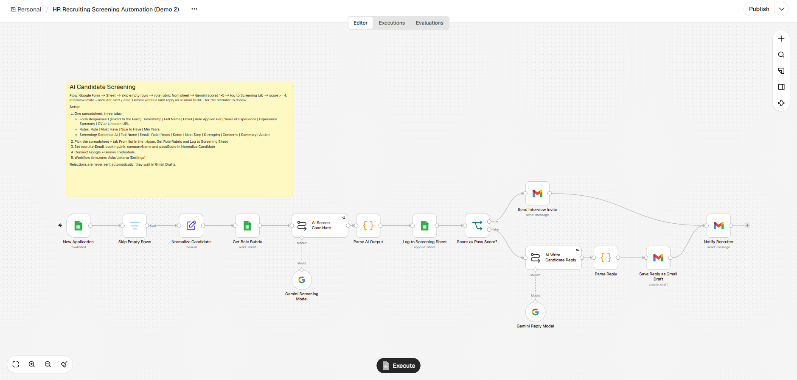

# HR Onboarding Automation

Onboarding, recruiting and HR workflow automation for small teams, built with [n8n](https://n8n.io) and Google Gemini.
Each demo below is a working workflow you can import into your own n8n instance.

| Demo | What it automates | Status |
|------|-------------------|--------|
| [1. Employee Onboarding](#demo-1--employee-onboarding) | New hire form → AI welcome email, shared checklist, Day-1 meeting, HR summary | ✅ |
| [2. AI Candidate Screening](#demo-2--ai-candidate-screening) | Job application form → Gemini scores against a role rubric → interview invite or reviewed reply draft, recruiter summary | ✅ |

---

## Demo 1 — Employee Onboarding


▶️ **Video walkthrough:** _available on request_

### Problem

Onboarding a new hire at a small/medium company is mostly copy-paste work for HR:

- Re-typing candidate data from a form or email into a spreadsheet
- Writing a welcome email by hand for every new hire
- Duplicating an onboarding checklist document
- Scheduling a first-day / orientation meeting
- Telling the rest of the HR team that someone new is starting

That is roughly **30–60 minutes per hire**, and steps get missed when HR is busy.

### Solution

One n8n workflow, triggered by a single Google Form submission:

```
Google Form → Google Sheet → Normalize → Gemini → Drive (copy + share) → Gmail → Calendar → Gmail
 (new hire)   (responses,     (clean     (writes   (personal onboarding   (welcome  (Day-1      (summary
               polled every    data,      welcome   checklist)             email)    meeting)    to HR)
               minute)         dates)     email)
```

1. **Google Sheets Trigger** — HR fills in a Google Form (name, personal email, position, department, start date, manager). n8n polls the linked response sheet every minute for new rows.
2. **Skip Empty Rows** — ignores blank rows (for example after someone clears old rows in the sheet), so they never reach the email or sharing steps.
3. **Normalize Data** — trims and lower-cases emails, extracts the first name, and converts the start date to `yyyy-MM-dd` whatever format the sheet returns.
4. **Gemini** — writes a personalised welcome email (subject + HTML body, max 140 words) based on role, department, manager and start date.
5. **Parse AI Output** — validates the JSON from Gemini; the run fails loudly instead of sending a broken email.
6. **Google Drive** — copies the onboarding checklist template, names it after the hire, and shares it with them.
7. **Gmail** — sends the welcome email with a link to the checklist.
8. **Google Calendar** — creates a 09:00–09:30 Day-1 meeting on the start date and invites the hire and their manager.
9. **Gmail** — sends HR a summary with links to the checklist and the calendar event.

### Results

| | Before | After |
|---|---|---|
| Time per new hire | ~30–60 min manual | < 1 min (fill one form) |
| Steps HR does by hand | 5–6 | 1 |
| Missed steps | Common when busy | Every step runs every time |
| Welcome email | Generic template | Personalised by Gemini |

_Estimates from the demo setup; actual savings depend on your hiring volume._

### Tech stack

- n8n (self-hosted, local via `npx n8n`)
- Google Gemini API (LLM for email copy)
- Google Workspace: Forms, Sheets, Gmail, Drive, Calendar

### Run it yourself

See [docs/setup-demo1.md](docs/setup-demo1.md).

---

## Demo 2 — AI Candidate Screening



### Problem

A recruiter or small agency with an open role gets dozens of applications, and the first pass is slow and repetitive:

- Reading every CV summary against the same must-have list
- Copying candidates into a tracking sheet
- Sending interview invites one by one
- Writing polite "not this time" replies, or never sending them at all

That is roughly **5–10 minutes per application** before any real interview starts, and good candidates wait days for an answer.

### Solution

One n8n workflow, triggered by a Google Form application:

```
Google Form → Sheet → Role rubric → Gemini → Validate → Screening log → Score ≥ 4?
 (candidate)  (responses) (Roles tab)  (score    (JSON     (Screening     ├─ yes → Gmail interview invite + booking link
                                       1–5)      check)    tab)           └─ no  → Gemini writes kind reply → Gmail DRAFT
                                                                                    (recruiter reviews before sending)
                                                                  both → recruiter summary email
```

1. **Google Sheets Trigger** — the candidate fills in a Google Form (name, email, role, years of experience, CV/LinkedIn summary, optional profile link). n8n polls the response sheet every minute.
2. **Skip Empty Rows** — blank rows never reach the AI or email steps.
3. **Normalize Candidate** — cleans the data and holds the settings: recruiter inbox, booking link, company name and pass score.
4. **Get Role Rubric** — reads the must-haves, nice-to-haves and minimum years for that role from a `Roles` tab. Recruiters change criteria in the sheet, not in n8n.
5. **Gemini screening** — scores the candidate 1–5 against the rubric and returns 3 strengths, 2 concerns, a suggested next step and a 40-word summary. The prompt tells it to judge skills only and ignore name, gender, age, religion, ethnicity and nationality.
6. **Parse AI Output** — validates the JSON and the score range; a bad AI answer stops the run instead of emailing a candidate. The route is decided by the score, so the AI cannot invite a low scorer.
7. **Screening log** — every candidate lands in a `Screening` tab with score, strengths, concerns, summary and the action taken.
8. **Score ≥ pass score** — Gmail sends an interview invite with the booking link.
9. **Score below pass score** — Gemini writes a short, kind hold or reject reply and saves it as a **Gmail draft**. Nothing reaches the candidate until a recruiter reads it and clicks Send.
10. **Recruiter summary** — one email per candidate with score, strengths, concerns and what happened.

### Results

| | Before | After |
|---|---|---|
| First-pass screening per application | ~5–10 min reading + notes | < 1 min reading the AI summary |
| Interview invite | Written by hand | Sent automatically for strong matches |
| Reply to weaker candidates | Often skipped | Drafted for every candidate, sent after human review |
| Tracking | Manual copy into a sheet | Every application scored and logged |

_Estimates from the demo setup; actual savings depend on application volume and how detailed the rubric is. The AI score is a first filter, not a hiring decision: a recruiter reviews every rejection before it is sent._

### Tech stack

- n8n (self-hosted, local via `npx n8n`)
- Google Gemini API (screening + reply writing)
- Google Workspace: Forms, Sheets, Gmail

### Run it yourself

See [docs/setup-demo2.md](docs/setup-demo2.md).

---

## Repository structure

```
workflows/     n8n workflow exports (.json) — import via n8n → Workflows → Import from file
screenshots/   workflow canvas + output screenshots used in this README
docs/          setup guides per demo
```

## Security note

Workflow JSON files in this repo contain **no API keys or OAuth tokens**. n8n stores credentials
separately; after importing, you create your own credentials and attach them to each node.
Spreadsheet IDs, folder IDs and email addresses in the exports are placeholders.

## License

MIT. Need this adapted to your HR process? [rifaldiradya.com](https://rifaldiradya.com)
