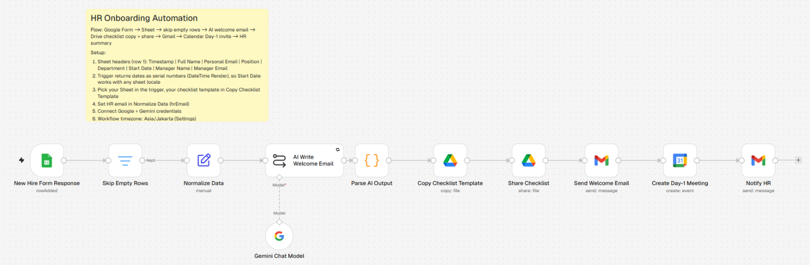

# HR Onboarding Automation

Onboarding and HR workflow automation for small teams, built with [n8n](https://n8n.io) and Google Gemini.
Each demo below is a working workflow you can import into your own n8n instance.

| Demo | What it automates | Status |
|------|-------------------|--------|
| [1. Employee Onboarding](#demo-1--employee-onboarding) | New hire form → AI welcome email, shared checklist, Day-1 meeting, HR summary | ✅ |

---

## Demo 1 — Employee Onboarding



▶️ **Video walkthrough:** [Watch the demo (Google Drive)](https://drive.google.com/file/d/19lsJ6VCuhCkXzuxrO5nFEEeYeCKG5pwa/view?usp=sharing)

### Problem

Onboarding a new hire at a small/medium company is mostly copy-paste work for HR:

- Re-typing candidate data from a form or email into a spreadsheet
- Writing a welcome email by hand for every new hire
- Duplicating an onboarding checklist document
- Scheduling a first-day / orientation meeting
- Telling the rest of the HR team that someone new is starting

That is roughly **30–60 minutes per hire**, and steps get missed when HR is busy.

### Solution

One n8n workflow, triggered by a single Google Form submission:

```
Google Form → Google Sheet → Normalize → Gemini → Drive (copy + share) → Gmail → Calendar → Gmail
 (new hire)   (responses,     (clean     (writes   (personal onboarding   (welcome  (Day-1      (summary
               polled every    data,      welcome   checklist)             email)    meeting)    to HR)
               minute)         dates)     email)
```

1. **Google Sheets Trigger** — HR fills in a Google Form (name, personal email, position, department, start date, manager). n8n polls the linked response sheet every minute for new rows.
2. **Skip Empty Rows** — ignores blank rows (for example after someone clears old rows in the sheet), so they never reach the email or sharing steps.
3. **Normalize Data** — trims and lower-cases emails, extracts the first name, and converts the start date to `yyyy-MM-dd` whatever format the sheet returns.
4. **Gemini** — writes a personalised welcome email (subject + HTML body, max 140 words) based on role, department, manager and start date.
5. **Parse AI Output** — validates the JSON from Gemini; the run fails loudly instead of sending a broken email.
6. **Google Drive** — copies the onboarding checklist template, names it after the hire, and shares it with them.
7. **Gmail** — sends the welcome email with a link to the checklist.
8. **Google Calendar** — creates a 09:00–09:30 Day-1 meeting on the start date and invites the hire and their manager.
9. **Gmail** — sends HR a summary with links to the checklist and the calendar event.

### Results

| | Before | After |
|---|---|---|
| Time per new hire | ~30–60 min manual | < 1 min (fill one form) |
| Steps HR does by hand | 5–6 | 1 |
| Missed steps | Common when busy | Every step runs every time |
| Welcome email | Generic template | Personalised by Gemini |

_Estimates from the demo setup; actual savings depend on your hiring volume._

### Tech stack

- n8n (self-hosted, local via `npx n8n`)
- Google Gemini API (LLM for email copy)
- Google Workspace: Forms, Sheets, Gmail, Drive, Calendar

### Run it yourself

See [docs/setup-demo1.md](docs/setup-demo1.md).

---

## Repository structure

```
workflows/     n8n workflow exports (.json) — import via n8n → Workflows → Import from file
screenshots/   workflow canvas + output screenshots used in this README
docs/          setup guides per demo
```

## Security note

Workflow JSON files in this repo contain **no API keys or OAuth tokens**. n8n stores credentials
separately; after importing, you create your own credentials and attach them to each node.
Spreadsheet IDs, folder IDs and email addresses in the exports are placeholders.

## License

MIT. Need this adapted to your HR process? [rifaldiradya.com](https://rifaldiradya.com)
